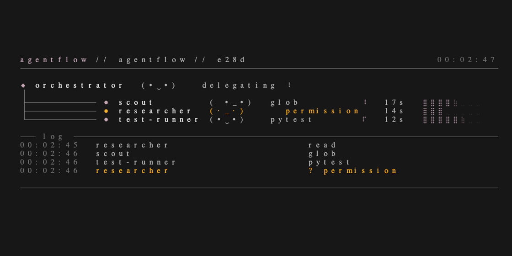

# agentflow

A cute cyberpunk terminal visualizer for Claude Code multi-agent sessions — little agents boot up, show faces, pass glowing data packets, and celebrate when they finish.



## Install

```sh
cargo install --git https://github.com/noahkostesku/agentflow
```

Or from source (needs Rust and a truecolor terminal):

```sh
git clone https://github.com/noahkostesku/agentflow
cd agentflow
cargo build --release      # -> target/release/agentflow
```

Optional alias so it runs anywhere:

```sh
echo 'alias aflow="agentflow"' >> ~/.zshrc && source ~/.zshrc
```

## Usage

```sh
agentflow            # live: watch the session for the current directory
agentflow --demo     # looping scripted demo (no session needed)
agentflow wrapped    # your month with agents, as six animated slides
```

| flag | meaning |
|------|---------|
| `--demo` | replay the scripted demo session on a loop |
| `--calm` | disable glitch, shimmer, and the finish wave (steady, low-motion) |
| `--session <id>` | watch a specific session id (pins it: no auto-switch) |
| `--project <path>` | watch the session for another directory (relative paths, `~`, symlinks and trailing slashes are resolved the way Claude Code names its project dirs) |
| `--no-cost` | hide the cost column, header total, and `+$` flashes |
| `--no-achievements` | no achievement popups |
| `--no-recap` | no recap card at the end |

**Controls:** `q` quit · `↑`/`↓` select an agent · `Enter` agent details ·
`Esc` back (out of a panel, then clears the selection, then quits) · `s` stats ·
`t` timeline · `l` lifetime · `?` key hints · `c` toggle calm · `space` pause (demo) ·
`r` restart (demo) / refresh now (live). The key hints show for ~3s on startup and on `?`.

## Agents up close

**Rarity** comes from the model and sits just before each agent's name:
`·` haiku (common) · `◆` sonnet (rare) · `✦` opus or fable (legendary).

**Personality** comes from what an agent actually does with its tools: **reader**
(read / grep / glob), **builder** (edit / write), **runner** (shell commands),
**researcher** (web fetch / search). The biggest share wins; edits and web calls
count double, since every agent reads but only some build or research. Shown in
the detail view and the stats panel.

**Detail view** — `↑`/`↓` moves a mauve `›` marker through the agents (one that
isn't on screen is swapped into the tree), `Enter` opens it: rarity, role, model,
personality, state, elapsed, cost, its task, the last nine tool calls
(`time · tool · short arg`, e.g. `bash  cargo test -q`, `read  render.rs`), and the
first lines of its final result. `Esc` goes back.

**Stuck alert** — a running agent whose transcript has gone quiet for 2+ minutes
dozes off: `(-_-)` with a slow `z z z` drifting up into the row above, and
`idle 2m` in amber. Any new transcript entry wakes it. Set the threshold with
`stuck_after` (seconds; `0` turns it off). A single long-running command (a slow
build) also writes nothing until it returns, so it can doze too.

## Cost, stats & achievements

Each row shows the agent's **model** (`haiku` / `sonnet` / `opus` / `fable`, dim,
after its name) and its **cost so far**, which briefly flashes `+$0.02` as each
call lands. The header shows the **session total** (orchestrator + every agent).

Cost is estimated from each response's `usage` (input, output, cache reads, and
5-minute / 1-hour cache writes) at Anthropic's first-party list prices. It ignores
batch/priority discounts, fast mode, and subscription plans, so treat it as "what
this would cost on the API", not your bill. Rates live in one table,
[`src/pricing.rs`](src/pricing.rs): exact model ids first, then a per-family
fallback so a new point release still gets a sane price. Unknown models cost $0
rather than a guess. You can override rates in the config without rebuilding.

**`s` stats** — per agent: a tokens/sec sparkline over its lifetime, average
tok/s, cache-hit %, and cost; the session's cache-hit %; the most-used tools; and
the five most-touched files as braille heat bars.

**`t` timeline** — swimlanes: one lane per agent, orchestrator first, across the
whole session. Each cell is braille as dense as the activity (tool calls and model
calls) in that slice of time: mauve while active, dim while waiting or idle, a red
`┃` where an error landed. Below: a time axis and `parallelism: peak N agents`.

**`l` lifetime** — totals across every session you've watched: sessions, agents,
spend, tokens, cache savings, fastest agent, achievements collected. Needs
`persistence` (on by default); stored in `~/.agentflow/lifetime.json`, one entry
per session id, so re-watching a session never double counts.

**Achievements** pop up one line at a time, fade after ~3s, and each fires once
per session. Only ones earned after agentflow attaches are announced.

| achievement | earned when |
|-------------|-------------|
| speedrun ✦ | an agent finishes in under 10s |
| pacifist ✦ | an agent finishes without editing a file |
| bug hunter ✦ | a test command (cargo test, pytest, npm test, go test, jest, …) fails, then a later one passes, in any agent |
| big spender ✦ | one agent costs more than $0.50 |
| team player ✦ | 3+ agents run at once |

Personality and rarity also show in the stats panel.

**Recap card** — when every agent has finished, the log is replaced by a recap:
total cost and tokens, MVP (the agent with the most output tokens), longest task,
and cache savings (what the cache reads would have cost as plain input). Any key
dismisses it; a new batch of agents gets a new recap.

## Config

On first run agentflow creates `~/.agentflow/config.toml` with every setting
commented out at its default. CLI flags win over the file; an invalid file falls
back to defaults with a warning.

```toml
achievements = true   # achievement popups
recap = true          # recap card when all agents finish
cost = true           # cost column + header total
flashes = true        # "+$0.02" flash per call
persistence = true    # lifetime totals for the `l` view and `wrapped`
accent = "#c4a5b4"    # the one accent color (dusty mauve)
stuck_after = 120     # seconds of silence before an agent dozes (0 = off)

[pricing.opus]        # USD per million tokens; key by family or exact model id
input = 4.0           # unset fields keep the built-in rate
output = 20.0
```

## Wrapped

```sh
agentflow wrapped                       # the last 30 days (default)
agentflow wrapped --week                # the last 7 days
agentflow wrapped --all                 # everything on record
agentflow wrapped --export wrapped.svg  # the outro card as an SVG, then exit
```

Six full-screen slides, each animating in (numbers count up, bars fill, text
types out). `space` / `→` next, `←` back, `q` quit:

1. **your agents, this month** — agents and sessions
2. **what it cost** — total spend and what the cache saved
3. **your top agent** — a character card for the role with the most output
   tokens: face, rarity (its most-used model), personality, runs
4. **your busiest hours** — a braille bar chart of tool calls by hour of day
5. **orchestrator type** — from average agents per session: soloist (≤1),
   duo (~2), conductor (3–4), swarm lord (5+)
6. **outro** — a summary card

`--export` writes the outro as a 1200×675 SVG (X's card size): `#0a0a0a`
background, your accent color, monospace type. With no history in the chosen
range yet, wrapped shows demo data and says so.

It reads `~/.agentflow/lifetime.json`, which agentflow fills while you watch
sessions (with `persistence` on). Sessions recorded before this version have no
start time or per-agent detail, so they only count toward `--all` totals.

## How it works

agentflow is **read-only** toward Claude Code. It watches the transcript `.jsonl`
files Claude Code already writes under `~/.claude/projects/` and renders them at
~20fps. It installs no hooks, writes nothing to `~/.claude`, and never touches your
sessions. Its only writes are its own `~/.agentflow/config.toml` (created once) and,
with `persistence` on, `~/.agentflow/lifetime.json`.

With no flags it picks, in order:

1. the most-recently-active session for your **current directory**, so running it
   in a repo watches that repo's session;
2. otherwise the **most recently active session across all projects**, showing
   that project's name in the header.

"Active" counts writes from background subagents too, so a session whose
agents are still working isn't mistaken for idle. Every ~2s it re-scans, and if
a newer session starts in the same directory it switches to it automatically
(unless you pinned one with `--session`).

It reads the main transcript for subagent spawns (so an agent appears the instant
it's dispatched) and tails each subagent's own transcript for live tool activity,
completion, and result size. Nothing is hardcoded to any one project.

## Roles

The main session is the **orchestrator** (`◆`). Each subagent is named by role:

| spawn | role |
|-------|------|
| `Explore` | scout |
| `general-purpose` | the role from a `role: task` description (e.g. `test-runner: run cargo tests` → test-runner); otherwise operator, or researcher if the task looks web/research-y |
| `Plan` | architect |
| custom `subagent_type` | used as-is (reviewer, test-runner, fixer, …) |

Per-agent status: booting `(·_·)→(•_•)` · active `(•‿•)` (reading glances
`(•_• )`, commands `(•o•)`) · waiting `(·_·)` in amber · done `(^‿^)` · error
`(×_×)` in red. Progress is indeterminate while an agent runs and snaps full when
it returns.

> Note on live waiting/error states: Claude Code records permission *decisions*
> only when they resolve, so agentflow can't see a prompt as it happens. It shows
> **waiting** when a tool call (shell, edit, web) hasn't returned for ~10s — that
> could be a permission prompt or just a slow command — and **error** when a tool
> was denied or blocked. Both are best-effort from a read-only transcript, no hooks.

## Why

Multi-agent runs are a wall of scrolling text; it's hard to feel what your agents
are actually doing. agentflow turns that firehose into a glanceable, calm little
dashboard — who's working, who's blocked, who's done — and makes watching your
agents work genuinely fun.

## License

MIT — see [LICENSE](LICENSE).
