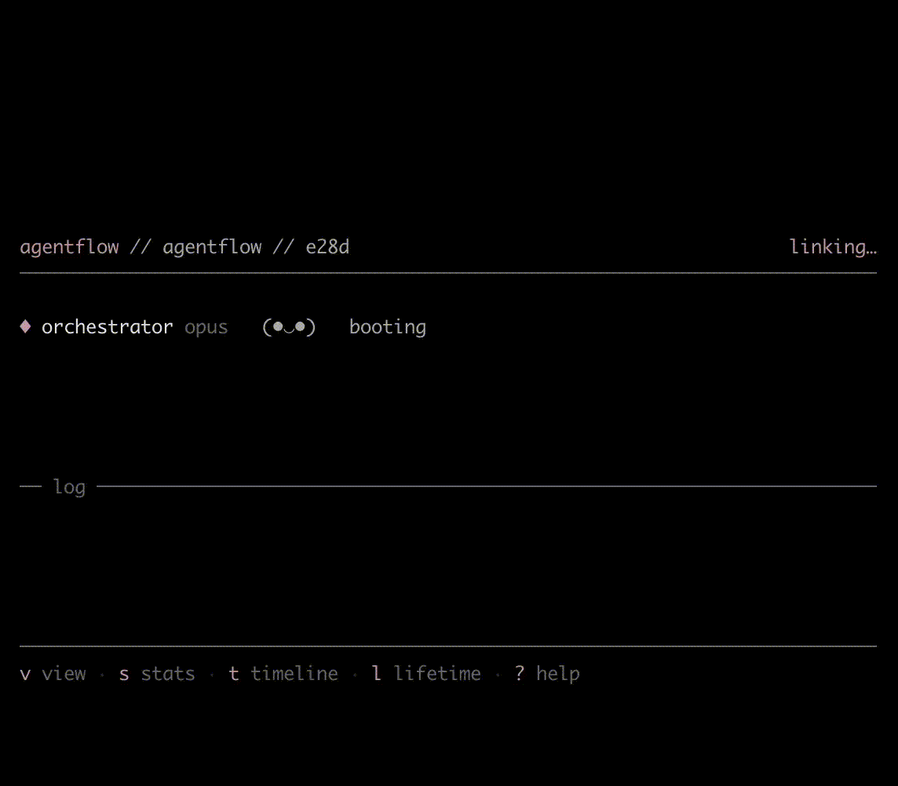

# agentflow

**One live view of every coding agent you run.**

agentflow is a full-screen terminal visualizer for coding-agent sessions:
Claude Code, Codex CLI, and more to come. Little agents boot up, show faces,
pass glowing data packets to each other, and celebrate when they finish. Run
Claude Code and Codex in the same repo and `--source all` shows both side by
side, on one clock, with one cost total.

It only reads the session files each harness already writes. Nothing to
install into your agents, no hooks, no proxy.



## Supported harnesses

| harness | status | sessions read from |
|---------|--------|--------------------|
| Claude Code | verified on 2.1.328, subagents and agent teams included | `~/.claude/projects/` |
| Codex CLI | verified on 0.170.0, subagents included | `$CODEX_HOME/sessions/` (default `~/.codex/sessions/`) |
| pi | planned | `~/.pi/agent/sessions/` |
| opencode | planned | `~/.local/share/opencode/opencode.db` |
| Gemini CLI | planned | |

"Verified" means checked against real sessions from that version, not only
synthetic fixtures. Formats change between releases; if a newer version
renders wrong, please open an issue with the version. To add a harness, see
[docs/adapters.md](docs/adapters.md).

## Install

Prebuilt binaries are available for macOS (Apple silicon and Intel) and Linux
(x86_64 and arm64). You'll want a truecolor terminal.

**Homebrew** (macOS, Linux):

```sh
brew install noahkostesku/tap/agentflow
```

**Shell installer** (macOS, Linux): downloads the right binary from the latest
[GitHub release](https://github.com/noahkostesku/agentflow/releases) into
`~/.cargo/bin`:

```sh
curl --proto '=https' --tlsv1.2 -LsSf https://github.com/noahkostesku/agentflow/releases/latest/download/agentflow-installer.sh | sh
```

**Cargo** (builds it; needs [Rust](https://rustup.rs)):

```sh
cargo install --locked --git https://github.com/noahkostesku/agentflow
```

**From source**:

```sh
git clone https://github.com/noahkostesku/agentflow
cd agentflow
cargo build --release      # -> target/release/agentflow
```

Then run `agentflow` in any project where you use Claude Code or Codex.

Optional alias so it runs anywhere:

```sh
echo 'alias aflow="agentflow"' >> ~/.zshrc && source ~/.zshrc
```

## Usage

```sh
agentflow                    # live: the newest session for this directory, any harness
agentflow --source codex     # only Codex sessions
agentflow --source all       # every harness's session for this directory, together
agentflow --demo             # looping scripted demo (no session needed)
agentflow --demo --source all  # the demo with Claude Code and Codex side by side
agentflow inbox              # every active session, any project: which one needs you
agentflow inbox --notify     # the same, plus a desktop notification when one does
agentflow notify             # just the notifications, no TUI (run it in the background)
agentflow inbox --demo       # a scripted inbox, sessions in every state
agentflow profile            # your workflows over time: which agent to fix
agentflow compare 1 2        # the latest run against the one before, side by side
agentflow wrapped            # your month with agents, as eight animated slides
agentflow events --json      # the session as normalized JSON events, live
```

| flag | meaning |
|------|---------|
| `--source <name>` | which harness to watch: `claude`, `codex`, or `all` for the mixed view (default: the most recently active session in any of them). `pi`, `opencode` and `gemini` are accepted but not built yet. |
| `--demo` | replay the scripted demo session on a loop |
| `--workflow <name>` | tag the runs recorded while watching as this workflow (see [Profiler](#profiler)) |
| `--calm` | disable glitch, shimmer, and the finish wave (steady, low-motion) |
| `--session <id>` | watch a specific session id (pins it: no auto-switch) |
| `--project <path>` | watch the session for another directory (relative paths, `~`, symlinks and trailing slashes are resolved the way the harnesses record them) |
| `--no-cost` | hide the cost column, header total, and `+$` flashes |
| `--no-achievements` | no achievement popups |
| `--no-recap` | no recap card at the end |

**Controls:** `q` quit · `v` cycle views (tree → orbit → timeline) · `↑`/`↓` select
an agent · `Enter` agent details · `Esc` back (out of a panel, then clears the
selection, then back to the tree, then quits) · `s` stats · `t` timeline · `l` lifetime ·
`i` inbox · `?` key hints · `c` toggle calm · `space` pause (demo) · `r` restart (demo) /
refresh now (live). The key hints show for ~3s on startup and on `?`.

## Views

`v` cycles three views of the same session; the header shows which one is up
(`v  tree · orbit · timeline`, the current one in mauve). Panels (`s`, `l`, the
detail view) open over the current view, and `Esc` returns to it.

- **tree**: the default. The orchestrator above a branch per agent, plus a log.
- **orbit**: the orchestrator in the center and its agents evenly spaced on a
  dim elliptical ring, starting at the top (up to 8; past that the busiest and the
  selected one get the seats). Each agent shows a face, its name, a status line,
  and a 6-cell braille trace that fills as it works. Dotted spokes carry dispatch
  and result packets (`· • ●`) between the center and each agent, so you can see
  who is waiting on whom. When one agent's result is fed into another agent's
  task, a temporary dotted chord joins the two and the packet travels along it
  instead (see *handoffs* below). The bottom line shows the latest dispatch,
  handoff, or result, e.g. `reviewer → fixer  findings 1.4kb`. It needs about
  25 rows; in a smaller terminal it falls back to the tree and says so.
  `↑`/`↓` and `Enter` work here too.
- **timeline**: swimlanes across the whole session (also on `t`; see below).

### Mixed view: `--source all`

Every harness's session for the project, together, for when you have Claude
Code and Codex working in the same repo at once:

- **tree**: grouped by harness. Each group has a dim label (`claude`,
  `codex`, with its share of the cost), its own root (`orchestrator`, or
  `you` when that harness's agent works alone), and its agents. The log below
  tags each line with its harness.
- **orbit**: one ring per harness, side by side, with the harness name dim
  above each. If they don't fit side by side they stack, given the rows; in a
  terminal too small for either, it shows the tree and says so.
- **timeline**: lanes grouped by harness, a dim divider and label between
  groups, all on one time axis.
- **header**: `agentflow // all // <project>` and the combined cost.
- **`s` stats**: a line per harness (agents, tool calls, cost, tokens) above
  the per-agent lines.

It shows the sessions active right now (written to in the last 10 minutes),
one per harness. If none is active it shows each harness's most recent
session for the project. Every ~2s it looks again: a harness that starts
working joins the view, and a newer session in a harness replaces the old one.

All sessions share one clock: `00:00:00` is the first agent's start in any
harness. `↑`/`↓` select across all agents, and the detail view names the
agent's harness.

**Handoffs** are detected, not guessed: a finished agent's result (or its agent
id) has to show up in a later agent's prompt, either whole or in at least two
distinctive lines (or one long one). A direct message from one agent to another
draws a chord too: a teammate's `SendMessage` in Claude Code's agent teams, a
subagent's `send_message` in Codex.

**Validators** (optional) are roles you name in the config, e.g.
`validators = ["test-runner", "reviewer"]`. In the orbit, a validator idles as
`validator`, shows `validating ⠹` while it works, then `✓ pass` or `✗ fail` (soft
red): an explicit `Verdict: …` line in its result wins, then the exit status of
its last test command, then its result's wording (`LGTM`, `changes requested`, …).
This is display only. agentflow just reads transcripts, so naming a validator
changes how it's drawn and gates nothing in your harness. None are set by default;
`--demo` shows the two above so you can see what they look like.

## Inbox: which agent needs you

For when you run many agents at once, across projects and harnesses.
`agentflow inbox` (or `i` from any view) lists every session written to in
the last 30 minutes, in any project and any supported harness, one line
each, the ones that need you first:

```
 agentflow // inbox        2 need you · 1 error · 1 stuck · 1 done · 2 working
 ─────────────────────────────────────────────────────────────────────────────
› ? (·_·)  claude  payments-api  $ cargo publish --dry…   1/3  4m 13s   ≈$1.84
  ? (·_·)  codex   infra         question: deploy to s…           42s   ≈$0.31
  ✗ (×_×)  claude  web-app       denied $ rm -rf node_…        1m 36s   ≈$0.22
  z (-_-)  codex   data-pipeline last: $ python etl.py…   1/2  6m 21s   ≈$0.67
  ✓ (^‿^)  claude  docs-site     Rewrote the quickstar…   0/2  1m 03s   ≈$0.48
  ⠏ (•‿•)  claude  agentflow     reviewer: read inbox.…   2/4 12m 15s   ≈$2.91
  ⠸ (•‿•)  codex   mobile        $ npm test -- --watch…        2m 09s   ≈$0.12
  ○ (·.·)  codex   scratch       closed while waiting …        1h 05m   ≈$0.09
  · (-‿-)  claude  dotfiles      Switched the prompt t…       25m 01s   ≈$0.05
```

| state | glyph | means |
|-------|-------|-------|
| waiting | `?` amber | blocked on you: an approval prompt, a question, a plan to approve |
| error | `✗` soft red | a tool call was denied or rejected |
| stuck | `z` dim amber | still running, but quiet past `stuck_after` with nothing in flight |
| done | `✓` mauve | the turn is over and you haven't reviewed it |
| working | spinner | busy |
| closed | `○` dim | was waiting or working, but its `claude` / `codex` process is gone (see below) |
| idle | `·` dim | reviewed, or nothing has happened in it yet |

Each line: the state's glyph and face, harness, project, what it's doing or
waiting on (the call, the question, the error, or its last message), agents
still running / total (when it has subagents), how long it's been in this
state, and the ≈cost so far. Within a state, whoever has waited longest is
first. The header counts each state.

`↑`/`↓` select (`j`/`k` too) · `Enter` opens the session in the usual
tree/orbit/timeline view · `Esc` from there comes back to the inbox · `r`
marks a done (or errored) session reviewed, so it drops to idle until it
finishes again · `q` quits. Reviewed marks are kept in
`~/.agentflow/reviewed.json` (never in a harness's directory); marks older than
two weeks are dropped.

Activity is the session's own: its last recorded event, subagents included,
not the file's modified time (Claude Code appends bookkeeping records to
transcripts long after the work ends). A session that's waiting on you or in
error stays listed after it goes quiet. Change the window with `--active
<minutes>` or `[inbox] active_minutes`. `--source claude` / `--source codex`
narrows it to one harness.

**Closed sessions.** Close a terminal (or kill the process) while its
session is waiting on you and the transcript just stops: on disk it looks
like it's still waiting. So every 10 seconds the inbox looks at the running
`claude` and `codex` processes (`ps`, and their working directory from
`lsof` on macOS or `/proc` on Linux). A process whose command line names a
session (`claude --resume <id>`) keeps that session live; otherwise, with
`n` processes of a harness in a directory, that harness's `n` most recently
active sessions there are the live ones (one sitting at its prompt counts).
A waiting, working or stuck session left without a process shows dim as
`closed while waiting` (or `working`), sorts below working, isn't counted in
the header, never notifies, and leaves the inbox with the active window.
Where processes can't be seen (no `ps`, a sandbox, a directory it can't
read), it falls back to age: one quiet for 12 hours or more reads
`stale while waiting`.

How waiting is detected, since neither harness records an approval prompt
while it's open:

- **Questions and plans** are exact: Claude Code's `AskUserQuestion` and
  `ExitPlanMode`, Codex's `request_user_input`. The line shows the question.
- **Approval prompts** are inferred: a call that can prompt hasn't returned
  for 10s. Which calls can prompt follows what each harness records about
  its permissions, so a slow build isn't mistaken for a prompt:
  - Claude Code's permission mode. In `auto` mode an edit still can (it
    returns at once unless you're being asked), but a shell command doesn't
    count: auto mode asks about ~3% of shell calls, while ~6% of the ones it
    lets through run longer than 10s, so a slow one is almost always just
    running. In `bypassPermissions` nothing can; in `acceptEdits` edits
    can't; in `default` and `plan` shell commands, edits and web calls can.
  - Codex's approval policy. Under `on-request` (its default) only a command
    that asks for escalated permissions can, and a patch only in a read-only
    sandbox; under `never`, nothing; under `untrusted`, any.

  A prompt the harness raises anyway (auto mode asking about a shell call)
  shows as working, with its time in that state growing.

## Notifications

`agentflow notify` runs without a TUI and sends a desktop notification when
a session starts waiting on you, hits an error, gets stuck, or finishes:
`osascript` on macOS, `notify-send` on Linux (if installed; otherwise it says
so and just prints). Each one is also printed to stdout with the time.
`agentflow inbox --notify` does the same while the inbox is open (and while
you're in a session you opened from it).

- One notification per state change per session. A state that holds never
  repeats.
- Starting it is silent: sessions already waiting or done when it starts
  don't fire. A session that shows up later, already waiting, does.
- A session that flips back into the same state within `repeat_after`
  seconds (default 300) isn't notified again. A slow command can flip a
  session between working and waiting.
- Per-state toggles and quiet hours are in the config (below). A change during
  quiet hours is dropped, not saved for later.

```sh
agentflow notify --dry-run   # print what it would send, send nothing
agentflow notify --once      # every active session's state, then exit
```

**Running it in the background.** In tmux:

```sh
tmux new -d -s agentflow-notify 'agentflow notify'
```

Or as a macOS login item with launchd. Save this as
`~/Library/LaunchAgents/dev.agentflow.notify.plist`, with the path from
`which agentflow`:

```xml
<?xml version="1.0" encoding="UTF-8"?>
<!DOCTYPE plist PUBLIC "-//Apple//DTD PLIST 1.0//EN" "http://www.apple.com/DTDs/PropertyList-1.0.dtd">
<plist version="1.0">
<dict>
  <key>Label</key>
  <string>dev.agentflow.notify</string>
  <key>ProgramArguments</key>
  <array>
    <string>/opt/homebrew/bin/agentflow</string>
    <string>notify</string>
  </array>
  <key>RunAtLoad</key>
  <true/>
  <key>KeepAlive</key>
  <true/>
  <key>StandardOutPath</key>
  <string>/tmp/agentflow-notify.log</string>
  <key>StandardErrorPath</key>
  <string>/tmp/agentflow-notify.log</string>
</dict>
</plist>
```

```sh
launchctl bootstrap gui/$(id -u) ~/Library/LaunchAgents/dev.agentflow.notify.plist   # start (and at every login)
launchctl bootout gui/$(id -u)/dev.agentflow.notify                                # stop
```

macOS shows `osascript` notifications as coming from Script Editor. If none
appear, allow Script Editor in System Settings → Notifications. If you use
`$CODEX_HOME`, add it under an `EnvironmentVariables` key in the plist.

## Agents up close

**Rarity** comes from the model and sits just before each agent's name:
`·` haiku (common) · `◆` sonnet (rare) · `✦` opus or fable (legendary).

**Personality** comes from what an agent actually does with its tools: **reader**
(read / grep / glob), **builder** (edit / write), **runner** (shell commands),
**researcher** (web fetch / search). The biggest share wins; edits and web calls
count double, since every agent reads but only some build or research. Shown in
the detail view and the stats panel.

**Detail view** — `↑`/`↓` moves a mauve `›` marker through the agents (one that
isn't on screen is swapped into the tree), `Enter` opens it: rarity, role, model,
personality, state, elapsed, cost, its task, the last nine tool calls
(`time · tool · short arg`, e.g. `bash  cargo test -q`, `read  render.rs`), and the
first lines of its final result. `Esc` goes back.

**Stuck alert** — a running agent whose transcript has gone quiet for 2+ minutes
dozes off: `(-_-)` with a slow `z z z` drifting up into the row above, and
`idle 2m 05s` in amber. Any new transcript entry wakes it. Set the threshold with
`stuck_after` (seconds; `0` turns it off). An agent with a tool call still in
flight (a slow build or test run: a `tool_use` with no `tool_result` yet) isn't
stuck: it stays awake and reads `busy 2m 05s` with a slow spinner. It only dozes
when nothing is in flight.

## Cost, stats & achievements

Each row shows the agent's **model** (`haiku` / `sonnet` / `opus` / `fable`, or
for OpenAI models their name, `luna` / `sol` / …, dim, after its name) and its
**cost so far**, which briefly flashes `+$0.02` as each call lands. The header
shows the **session total** (orchestrator + every agent), and in the mixed view
the total across harnesses.

**Costs are API-equivalent, not your bill.** They're computed from each
response's token usage (input, output, cache reads and writes) at the
provider's pay-per-token list prices (Anthropic's for Claude models, OpenAI's
for GPT models), which is why they're shown with `≈`. If you use a
subscription (Claude Pro/Max, ChatGPT Plus/Pro) you aren't billed per token,
and batch or priority discounts and fast mode aren't modeled either. Treat the
number as "what this usage would cost on the API". Rates live in one table,
[`src/pricing.rs`](src/pricing.rs), each with the date it was last checked:
exact model ids first, then a per-family fallback so a new point release
still gets a sane price. A model with no known price counts as $0 and puts a
`?` after the header total; the stats panel names it. You can override rates
in the config without rebuilding.

**`s` stats** — per agent: a tokens/sec sparkline over its lifetime, average
tok/s, cache-hit %, and cost; the session's cache-hit %; the most-used tools; how
parallel the agents ran (`team` line, see below); and the four most-touched files
as braille heat bars.

**`t` timeline** — swimlanes: one lane per agent, orchestrator first, across the
whole session. Each cell is braille as dense as the activity (tool calls and model
calls) in that slice of time: mauve while active, dim while waiting or idle, a red
`┃` where an error landed. The **critical path** (the chain of agents that set how
long the session took) is drawn in brighter mauve. Below: a time axis and the
parallelism line.

**Parallelism** (timeline and stats), measured over each agent's run from dispatch
to finish, across the window from the first dispatch to the last agent's end:

- **peak**: most agents running at once
- **avg 1.7×**: average agents running over that window (total agent time ÷ wall-clock)
- **2+ active 42%**: share of the window with two or more agents running
- **time saved**: total agent time vs wall-clock, e.g. `8m of work in 3m · saved 5m`
  (in the timeline's header; the stats line drops it when the terminal is too narrow)

The critical path starts at the agent that ended last and steps back to the agent
it waited on: the last one to finish before it was dispatched (a handoff to it
breaks ties). Agents that ran alongside it, off that chain, didn't change how long
the session took.

**`l` lifetime** — totals across every session you've watched: sessions, agents,
spend, tokens, cache savings, fastest agent, achievements collected, and the same
per harness (sessions, agents, cost, tokens). Needs `persistence` (on by
default); stored in `~/.agentflow/lifetime.json`, one entry per session id with
the harness it ran in, so re-watching a session never double counts. Entries
written before agentflow read more than Claude Code have no harness and count as
Claude Code.

**Achievements** pop up one line at a time, fade after ~3s, and each fires once
per session. Only ones earned after agentflow attaches are announced.

| achievement | earned when |
|-------------|-------------|
| speedrun ✦ | an agent finishes in under 10s |
| pacifist ✦ | an agent finishes without editing a file |
| bug hunter ✦ | a test command (cargo test, pytest, npm test, go test, jest, …) fails, then a later one passes, in any agent |
| big spender ✦ | one agent costs more than $0.50 |
| team player ✦ | 3+ agents run at once |

Personality and rarity also show in the stats panel.

**Recap card** — when every agent has finished, the log is replaced by a recap:
total cost and tokens, MVP (the agent with the most output tokens), longest task,
and cache savings (what the cache reads would have cost as plain input). Any key
dismisses it; a new batch of agents gets a new recap.

## Config

On first run agentflow creates `~/.agentflow/config.toml` with every setting
commented out at its default. CLI flags win over the file; an invalid file falls
back to defaults with a warning.

```toml
achievements = true   # achievement popups
recap = true          # recap card when all agents finish
cost = true           # cost column + header total
flashes = true        # "+$0.02" flash per call
persistence = true    # lifetime totals for the `l` view and `wrapped`
accent = "#c4a5b4"    # the one accent color (dusty mauve)
stuck_after = 120     # seconds of silence before an agent dozes (0 = off)
validators = ["test-runner", "reviewer"]  # optional: pass/fail labels in the orbit (default: none)

[inbox]
active_minutes = 30   # a session written to this recently shows in the inbox

[notify]              # `agentflow notify` and `inbox --notify`
waiting = true        # it's waiting on you (a prompt, a question, a plan)
error = true          # a tool call was denied or rejected
stuck = true          # quiet past stuck_after with nothing in flight
done = true           # it finished its turn
quiet = "22:00-08:00" # no notifications in this local-time window (default: none)
repeat_after = 300    # seconds before the same state re-notifies a session (0 = always)

[pricing.opus]        # USD per million tokens; key by family or exact model id
input = 4.0           # unset fields keep the built-in rate
output = 20.0
```

## Wrapped

```sh
agentflow wrapped                       # the last 30 days (default)
agentflow wrapped --week                # the last 7 days
agentflow wrapped --all                 # everything on record
agentflow wrapped --export wrapped.svg  # the outro card as an SVG, then exit
```

Eight full-screen slides, each animating in (numbers count up, bars fill, text
types out). `space` / `→` next, `←` back, `q` quit:

1. **your agents, this month** — agents and sessions
2. **what it cost** — API-equivalent usage and what the cache saved
3. **your tools** — per harness: sessions, agent time and API-equivalent usage,
   with a small braille bar of agent time
4. **your top agent** — a character card for the role with the most output
   tokens: face, rarity (its most-used model), the harness it ran in,
   personality, runs
5. **your busiest hours** — a braille bar chart of tool calls by hour of day
6. **time saved** — total agent time vs the wall-clock it took, as two bars
   ("11h 20m of agent work in 6h 5m"), and the difference: time saved by running
   agents in parallel
7. **orchestrator type** — from average agents per session: soloist (≤1),
   duo (~2), conductor (3–4), swarm lord (5+)
8. **outro** — a summary card

`--export` writes the outro as a 1200×675 SVG (X's card size): `#0a0a0a`
background, your accent color, monospace type. With no history in the chosen
range yet, wrapped shows demo data and says so.

It reads `~/.agentflow/lifetime.json`, which agentflow fills while you watch
sessions (with `persistence` on). Sessions recorded before this version have no
start time or per-agent detail, so they only count toward `--all` totals; sessions
recorded before time saved existed are left out of it.

## Profiler

For people who design and rerun agent workflows (custom subagents,
orchestration prompts) and want them faster and cheaper: is a workflow getting
better or worse, and which agent should you fix?

```sh
agentflow profile                       # your workflows: runs, medians, trends
agentflow profile --workflow pr-review  # straight to one workflow's detail
agentflow profile --demo                # seeded history (12 runs, one regression)
agentflow compare 1 2                   # the latest run against the one before
agentflow compare 3f2a91c0 9be0d4e1     # two runs by id prefix, any harness
agentflow compare 1 2 --workflow pr-review  # numbers count within a workflow
```

**Runs.** Every finished session becomes a run in `~/.agentflow/runs.jsonl`:
project, harness, start, wall time (orchestrator included), total agent time,
the critical path, peak and average concurrency, ≈cost and tokens per agent
(role and model), tool calls, errors, and outcome (did the last test command
pass, did any agent end in error or never report back). Live mode records a
session 30s after its batch of agents finishes (so the orchestrator's wrap-up
counts) and on exit; `profile` and `compare` also index the current project's
sessions (`--project` for another) that have been quiet for 10 minutes and
aren't on record yet. With `persistence` off nothing is recorded; `profile`
then shows only what it indexes from the project's sessions.

**Workflows.** Runs group by project plus the set of agent roles (a Codex
subagent counts by its path, `repo_overview`, not its nickname). Name one, and
group runs that sometimes add an extra agent, in the config:

```toml
[workflows.pr-review]
roles = ["scout", "reviewer", "fixer"]   # runs with at least these roles
project = "~/code/shop-api"              # optional
```

or tag runs as you watch: `agentflow --workflow pr-review`.

**`profile`** lists workflows with their run count, median wall time, median
≈cost and a braille trend of wall time. `↑`/`↓` and `Enter` open one: wall
and cost trends over the last 20 runs (`--last N`), a ✓/✗ outcome strip, a
per-role table (median time, ≈cost, model, share of runs on the critical
path), recent runs with their ids, and up to three insights once there are 5
runs, such as *"scout is on the critical path in 83% of runs"* or *"reviewer
on opus costs 25× scout on haiku with similar duration"*. A role or the whole
run more than 25% slower or costlier than its median over the previous 10 runs
is flagged in amber (it needs 3 earlier runs, and ignores differences under 2s
or half a cent). `--print` prints the screen once; piped output is plain text.

**`compare`** puts two runs side by side: wall and agent time, cost, tokens,
agents, concurrency, critical path, tool calls, outcome, then per role. It
works across harnesses, such as the same task in Claude Code and in Codex.

## How it works

agentflow is **read-only** toward every harness. It watches the session files
they already write (Claude Code's transcripts under `~/.claude/projects/`,
Codex's rollouts under `~/.codex/sessions/`) and renders them at ~20fps. It
installs no hooks, writes nothing to any harness's directories, and never
touches your sessions. Its only writes are its own `~/.agentflow/config.toml`
(created once), with `persistence` on `~/.agentflow/lifetime.json` and the
profiler's run history `~/.agentflow/runs.jsonl`, and the inbox's reviewed
marks, `~/.agentflow/reviewed.json`.

Each harness has an **adapter** that translates its files into one normalized,
versioned [event schema](docs/schema.md). Every view, stat and feature reads
only those events, so they work the same for every harness. See
[docs/architecture.md](docs/architecture.md).

With no flags it picks, in order:

1. the most-recently-active session for your **current directory**, in any
   supported harness, so running it in a repo watches that repo's session;
2. otherwise the **most recently active session across all projects**, showing
   that project's name in the header.

`--source <harness>` narrows that to one harness; `--source all` shows one
session per harness together (see *Mixed view*). "Active" counts writes from
background subagents too, so a session whose agents are still working isn't
mistaken for idle. Every ~2s it re-scans, and if a newer session starts in the
same directory it switches to it automatically (unless you pinned one with
`--session`).

Subagents appear the instant they're dispatched, and each one's own file is
tailed for live tool activity, completion, and result size. Nothing is
hardcoded to any one project.

## Events: `agentflow events --json`

The same normalized stream the views use, for your own tools: one JSON object
per line on stdout, the session so far and then live as it grows.

```sh
agentflow events --json                       # follow the newest session here
agentflow events --json --once                # what's on disk now, then exit
agentflow events --json --source all          # every harness's session, interleaved
agentflow events --json | jq 'select(.type == "tool_started") | .arg'
```

```json
{"v":1,"harness":"codex","session":"01a1f49c","ts":1795105280113,"type":"tool_started","agent":"main","tool":"bash","label":"cargo","kind":"run","arg":"cargo test","blocking":true,"test":true}
```

Every event carries the schema version, its harness and session id, so a
mixed stream can be split back apart. The fields and rules are documented in
[docs/schema.md](docs/schema.md). It exits quietly when the reader goes away
(`| head`).

## Roles

A session's main agent is the one working row, named after its harness
(`claude`, `codex`) under **you** (`◆`), until it spawns a subagent. From then on
it's the **orchestrator** (`◆`) and each subagent gets a row.

Codex subagents are named by their nickname (`socrates`), with their path as a
dim tag where there's room (`socrates · repo_overview`). Claude Code subagents
are named by role:

| spawn | role |
|-------|------|
| `Explore` | scout |
| `general-purpose` | the role from a `role: task` description (e.g. `test-runner: run cargo tests` → test-runner); otherwise operator, or researcher if the task looks web/research-y |
| `Plan` | architect |
| custom `subagent_type` | used as-is (reviewer, test-runner, fixer, …) |

Per-agent status: booting `(·_·)→(•_•)` · active `(•‿•)` (reading glances
`(•_• )`, commands `(•o•)`) · waiting `(·_·)` in amber · done `(^‿^)` · error
`(×_×)` in red. Progress is indeterminate while an agent runs and snaps full when
it returns.

> Note on live waiting/error states: neither harness records a permission prompt
> while it's open, so agentflow can't see one as it happens. It shows **waiting**
> at once for a question or a plan to approve, and when a call that can prompt
> (under the session's permission mode or approval policy; see *Inbox*) hasn't
> returned for ~10s. It shows **error** when a tool was denied or rejected. Both
> are best-effort from read-only session files, no hooks.

## Why

Multi-agent runs are a wall of scrolling text, often in several terminals at
once; it's hard to feel what your agents are actually doing. agentflow turns that firehose into a glanceable, calm little
dashboard — who's working, who's blocked, who's done — and makes watching your
agents work genuinely fun.

## License

MIT — see [LICENSE](LICENSE).
